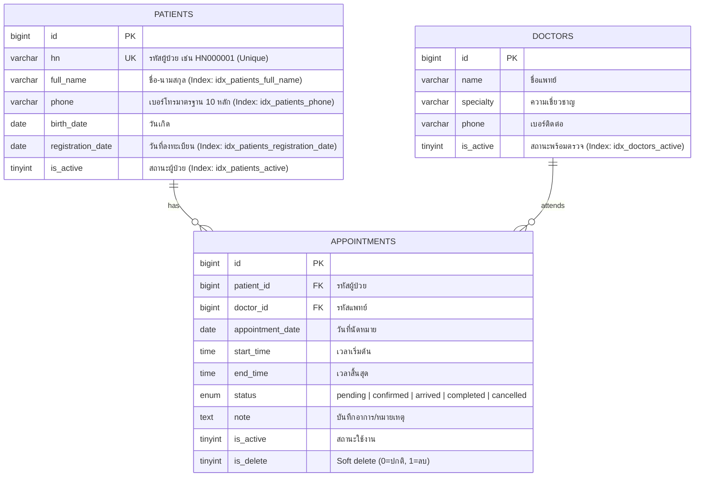

# Bestar-one Luxury Clinic - ระบบนัดหมายคลินิก

ระบบนัดหมายคลินิกขนาดเล็ก (Clinic Appointment System) ที่ออกแบบและพัฒนาขึ้นตามโจทย์ทดสอบโปรแกรมเมอร์ของ **Bestar-one** โดยเน้นความถูกต้องของ Business Logic, สถาปัตยกรรมโค้ดที่สะอาด เป็นระเบียบ จัดกลุ่มฟังก์ชันตามหน้าการทำงานในรูปแบบ OOP ภายใต้โฟลเดอร์ `/api`, หน้าเว็บสไตล์ Flat Design Corporativo ตกแต่งด้วย **Bootstrap 5.3.3 (CDN) + Vue 2 (CDN)**, ระบบป้องกันการนัดหมายเวลาซ้อนกันอย่างแม่นยำ และการออกแบบฐานข้อมูลที่รองรับปริมาณข้อมูลขนาดใหญ่ระดับ 100,000+ แถวได้อย่างมีประสิทธิภาพ

---

## สารบัญ

1. [ภาพรวมฟีเจอร์ของระบบ](#ภาพรวมฟีเจอร์ของระบบ)
2. [สถาปัตยกรรมระบบและโครงสร้างไฟล์](#สถาปัตยกรรมระบบและโครงสร้างไฟล์)
3. [วิธีติดตั้งและรันทีละขั้นตอน (Step-by-step Setup)](#วิธีติดตั้งและรันทีละขั้นตอน)
4. [การออกแบบฐานข้อมูลและการใส่ Index (Database &amp; Indexing Rationale)](#การออกแบบฐานข้อมูลและการใส่-index)
5. [การทำงานของระบบเช็คนัดชน (Overlap Prevention Engine)](#การทำงานของระบบเช็คนัดชน)
6. [ข้อจำกัดที่รู้อยู่และส่วนที่สามารถพัฒนาต่อยอด (Known Limitations)](#ข้อจำกัดที่รู้อยู่และส่วนที่สามารถพัฒนาต่อยอด)
7. [การเปิดเผยการใช้งาน AI (AI Disclosure)](#การเปิดเผยการใช้งาน-ai)
8. [โครงร่างสคริปต์สำหรับบันทึกคลิปวิดีโอ 10–15 นาที](#โครงร่างสคริปต์สำหรับบันทึกคลิปวิดีโอ-1015-นาที)

---

## ภาพรวมฟีเจอร์ของระบบ

ระบบครอบคลุมทั้ง 4 ฟีเจอร์หลักตามเกณฑ์ของโจทย์ พร้อมระบบจัดการและเสริมความปลอดภัยของข้อมูล:

1. **ระบบจัดการข้อมูลผู้ป่วย (Patient Management - `page/patients.php`)**

   - **ลงทะเบียนและแก้ไขข้อมูล**: บันทึกชื่อ-นามสกุล, เบอร์โทรศัพท์, วันเกิด และสถานะการใช้งาน ผ่าน Modal สวยงาม
   - **ระบบออกรหัส HN อัตโนมัติ**: จัดรูปแบบ `HN000001` โดยเรียงลำดับต่อเนื่อง ไม่ซ้ำซ้อน
   - **Phone Normalization Engine**: แปลงเบอร์โทรศัพท์ทุกรูปแบบ เช่น `081-234-5678`, `+66812345678`, `66 81 234 5678`, `+66 81-234-5678` ให้จัดเก็บเป็นรูปแบบมาตรฐาน `0812345678` เสมอ
   - **Live AJAX Search & Pagination**: ค้นหาผู้ป่วยแบบ Real-time (Debounce) ตามชื่อ, HN หรือเบอร์โทรศัพท์ พร้อม Pagination โดยไม่ต้องรีเฟรชหน้าเว็บ
2. **ระบบนัดหมายแพทย์ (Appointment Scheduling - Modal ใน `page/index.php`)**

   - **สร้างและแก้ไขการนัดหมาย**: เลือกผู้ป่วย, แพทย์ผู้ตรวจ, วันที่, เวลาเริ่มต้น และเวลาสิ้นสุด ผ่าน Modal
   - **ช่วงเวลามาตรฐาน (Time Slots)**: ให้บริการตั้งแต่ 08:00 - 20:30 น. (แบ่งช่วงละ 30 นาที) จัดการผ่าน Master Data Service
   - **Real-time Overlap Conflict Check**: ระบบตรวจสอบนัดชนกันทันทีผ่าน AJAX ทั้งในขั้นตอนสร้างนัดหมายใหม่และแก้ไขนัดเดิม
   - **นัดที่ยกเลิกไม่นับว่าชน**: นัดหมายที่มีสถานะ `cancelled` หรือถูกลบ (`is_delete = 1`) จะไม่ถูกนำมานับว่าชน
   - **ตรวจขอบเขตเวลา**: ตรวจสอบว่าเวลาเริ่มต้นต้องมาก่อนเวลาสิ้นสุดเสมอ
3. **หน้ารายการนัดของวันนี้ (Today's Schedule & Queue - `page/index.php`)**

   - แสดงคิวนัดหมายประจำวันเรียงลำดับตามเวลา (`start_time ASC`) ดึงข้อมูลผ่าน AJAX แบบแบ่งหน้า (Pagination)
   - **ตัวกรองอเนกประสงค์**: กรองตามแพทย์ผู้ตรวจ, วันที่นัดหมาย, ผู้ป่วย หรือสถานะนัดหมายได้ทันที
   - **เปลี่ยนสถานะทันที (Status Badges)**: รองรับสถานะ **รอเข้ารับบริการ** (`pending`) / **ยืนยันแล้ว** (`confirmed`) / **มาแล้ว** (`arrived`) / **เสร็จสิ้น** (`completed`) / **ยกเลิก** (`cancelled`)
   - **แก้ไขและลบแบบปลอดภัย**: มีปุ่มแก้ไข (ไอคอนดินสอ) เพื่อเปิด Modal แก้ไขข้อมูล และปุ่มถังขยะพร้อม Modal ยืนยันก่อนทำการ Soft Delete (`is_delete = 1`)
4. **รายงานสรุปและสถิติ (High-Volume Analytics Dashboard - `page/reports.php`)**

   - เลือกช่วงวันที่เพื่อสรุปภาพรวมคลินิกและสถิติรายแพทย์ผ่าน AJAX
   - **Executive Metrics (5 มิติ)**: ผู้ป่วยใหม่, นัดหมายรวม, รอเข้ารับบริการ, เสร็จสิ้น, ยกเลิก
   - **Doctor Breakdown พร้อม Pagination**: แสดงสถิติการตรวจของแพทย์แต่ละท่าน แบ่งหน้าตามจำนวนที่กำหนด ป้องกันหน้าเว็บหน่วงเมื่อมีแพทย์หรือข้อมูลจำนวนมาก
   - ออกแบบ SQL Query และ Composite Indexes รองรับตารางที่มีข้อมูลมากกว่า 100,000 แถวได้อย่างรวดเร็ว

---

## สถาปัตยกรรมระบบและโครงสร้างไฟล์

ระบบจัดกลุ่ม Business Logic เป็น **OOP Classes ภายใต้โฟลเดอร์ `/api` โดยแยกโฟลเดอร์ตามหน้าการทำงาน** แต่ละโฟลเดอร์มีไฟล์ Class รับผิดชอบ Logic หลัก และไฟล์ `ajax.*.php` รับส่งข้อมูลรูปแบบ JSON:

```
bstarone_test/
├── api/                                # Backend Business Logic (OOP) & AJAX Endpoints
│   ├── config/
│   │   └── database.php                # PDO Connection (Singleton Pattern + utf8mb4)
│   ├── index/                          # หน้ารายการนัดหมายวันนี้ & การจัดการนัดหมาย
│   │   ├── class.index.php             # ClassIndex: getOverview, create, update, delete, checkConflict
│   │   └── ajax.index.php              # Actions: getOverview, saveAppointment, deleteAppointment
│   ├── masterdata/                     # ข้อมูลพื้นฐานส่วนกลาง (Master Data)
│   │   ├── class.masterdata.php        # ClassMasterData: แพทย์, ผู้ป่วย, สถานะนัด, ช่วงเวลาตรวจ
│   │   └── ajax.masterdata.php         # Actions: getMasterDoctor, getMasterPatient, getMasterAppointmentStatus, etc.
│   ├── patients/                       # ระบบจัดการข้อมูลผู้ป่วย
│   │   ├── class.patient.php           # ClassPatient: normalizePhone, generateHN, getOverview, create, update, delete
│   │   └── ajax.patient.php            # Actions: getOverview, savePatient, deletePatient
│   └── reports/                        # หน้ารายงานสรุปเชิงสถิติ
│       ├── class.report.php            # ClassReport: getSummary (คำนวณ 5 Metrics + Doctor Breakdown + Pagination)
│       └── ajax.report.php             # Action: getOverview
├── page/                               # Frontend Views (Flat Design Corporativo + Vue 2 + Bootstrap 5.3.3)
│   ├── header.php                      # ส่วนหัว Navbar, Navigation Links และ CSS Corporate Palette
│   ├── footer.php                      # ส่วนท้ายและสคริปต์ Bootstrap 5.3.3 Bundle
│   ├── index.php                       # หน้ารายการนัดของวันนี้ + Modal สร้าง/แก้ไขนัดหมาย + Confirm Delete Modal
│   ├── patients.php                    # หน้าจัดการข้อมูลผู้ป่วย + Modal ลงทะเบียน/แก้ไข + Confirm Delete Modal
│   └── reports.php                     # หน้ารายงานสรุปเชิงสถิติ + Doctor Breakdown Table พร้อม Pagination
├── database/
│   ├── schema.sql                      # DDL สร้างตาราง doctors, patients, appointments พร้อม Composite Indexes
│   └── seed.sql                        # ชุดข้อมูลทดสอบขนาดใหญ่ (18,000+ บรรทัด: ผู้ป่วย 5,000 ราย, นัดหมาย 12,000+ รายการ)
├── docs/
│   └── โจทย์ทดสอบ-ระบบนัดหมายคลินิก.pdf
├── Dockerfile                          # PHP 8.2-FPM พร้อม Extensions pdo, pdo_mysql
├── nginx.conf                          # Nginx Web Server Configuration (Reverse Proxy to PHP-FPM)
├── docker-compose.yml                  # Container Orchestration (clinic_web:8080, clinic_app, clinic_db:3306)
├── index.php                           # Entrypoint Root (Redirect ไปยัง /page/index.php)
├── .env.example                        # ตัวอย่าง Environment Variables
└── README.md                           # เอกสารอธิบายระบบฉบับสมบูรณ์
```

---

## วิธีติดตั้งและรันทีละขั้นตอน

### วิธีที่ 1: รันผ่าน Docker Compose (แนะนำ สะดวกและพร้อมใช้งานที่สุด)

ระบบตั้งค่าให้ Initialise ฐานข้อมูลและ Import ข้อมูลตัวอย่างขนาดใหญ่ (`schema.sql` และ `seed.sql`) อัตโนมัติเมื่อสร้าง Container ครั้งแรก:

1. เปิด Terminal ในโฟลเดอร์โปรเจกต์
2. สั่งรันคำสั่ง:

   ```bash
   docker compose up -d
   ```
3. รอจนกว่า Container ทั้ง 3 ตัว (`clinic_db`, `clinic_app`, `clinic_web`) ทำงานเรียบร้อย (ตรวจสอบได้ด้วย `docker compose ps`)
4. เปิดเว็บเบราว์เซอร์แล้วเข้าใช้งานได้ทันทีที่:

   ```
   http://localhost:8080
   ```

   *(หรือเข้าหน้ารายการนัดหมายโดยตรงที่ `http://localhost:8080/page/index.php`)*

> [!TIP]
> หากต้องการรีเซ็ตฐานข้อมูลและนำเข้าข้อมูลใหม่ตั้งแต่ต้น สามารถใช้คำสั่ง:
>
> ```bash
> docker compose down -v
> docker compose up -d
> ```

---

### วิธีที่ 2: รันผ่าน Local Environment (เช่น XAMPP / Laragon / PHP CLI)

1. สร้างฐานข้อมูล MySQL และนำเข้าไฟล์ SQL:
   ```bash
   mysql -u root -p -e "CREATE DATABASE clinic_db CHARACTER SET utf8mb4 COLLATE utf8mb4_unicode_ci;"
   mysql -u root -p clinic_db < database/schema.sql
   mysql -u root -p clinic_db < database/seed.sql
   ```
2. ตรวจสอบการตั้งค่าการเชื่อมต่อใน [api/config/database.php](file:///c:/Users/Korakoch.s/Desktop/CN-It/tutorial/bstarone_test/api/config/database.php) ให้ตรงกับเครื่องของคุณ (หรือกำหนดผ่าน Environment Variables: `DB_HOST`, `DB_NAME`, `DB_USER`, `DB_PASS`)
3. สั่งรันเว็บเซิร์ฟเวอร์ PHP ในโฟลเดอร์โปรเจกต์:
   ```bash
   php -S localhost:8080
   ```
4. เปิดเบราว์เซอร์ไปที่ `http://localhost:8080`

---

## การออกแบบฐานข้อมูลและการใส่ Index

เพื่อรองรับเกณฑ์ **"ควรคิดเผื่อกรณีที่ข้อมูลมีหลักแสนแถวด้วย"** ฐานข้อมูลได้รับการออกแบบโครงสร้างแบบ Relational ร่วมกับ Composite B-Tree Indexes อย่างมีหลักการ:



### เหตุผลและความจำเป็นในการเลือกใส่ Index แต่ละตำแหน่ง:

| ตาราง       | ชื่อ Index                                     | คอลัมน์ที่ทำการ Index                            | เหตุผลเชิงประสิทธิภาพและความคุ้มค่า                                                                                                                                                                                     |
| :--------------- | :------------------------------------------------- | :-------------------------------------------------------------- | :--------------------------------------------------------------------------------------------------------------------------------------------------------------------------------------------------------------------------------------------------------- |
| `appointments` | `idx_appointments_overlap_check`                 | `(doctor_id, appointment_date, status, start_time, end_time)` | **หัวใจของระบบเช็คนัดชน**: เมื่อนัดหมายมีหลักแสนแถว Query ตรวจสอบนัดซ้อนจะค้นหาได้ในเวลา $O(\log N)$ ผ่าน Composite Index โดยไม่ต้องทำ Full Table Scan  |
| `appointments` | `idx_appointments_today_queue`                   | `(appointment_date, doctor_id, start_time)`                   | **หน้ารายการนัดของวันนี้**: รองรับ `WHERE appointment_date = ?` พร้อม `ORDER BY start_time ASC` ทำให้ดึงข้อมูลขึ้นมาได้ทันทีโดยไม่ต้อง Sorting ในหน่วยความจำ |
| `appointments` | `idx_appointments_report_date_status`            | `(appointment_date, status)`                                  | **หน้ารายงานสรุป**: สำหรับ `WHERE appointment_date BETWEEN ? AND ?` และ `GROUP BY status` ทำงานเป็น Covering Index ได้ทันที                                                                              |
| `patients`     | `idx_patients_registration_date`                 | `(registration_date)`                                         | **การนับผู้ป่วยใหม่ในรายงาน**: เร่งความเร็วการนับ `COUNT(*)` ผู้ป่วยใหม่ตามช่วงวันที่ลงทะเบียนได้อย่างฉับไว                                               |
| `patients`     | `idx_patients_phone`, `idx_patients_full_name` | `(phone)`, `(full_name)`                                    | **ระบบค้นหาผู้ป่วยแบบเรียลไทม์**: ค้นหาตามเบอร์โทรที่ถูก Normalize แล้ว หรือชื่อ-นามสกุลได้อย่างรวดเร็ว                                                          |
| `patients`     | `idx_patients_active`                            | `(is_active, full_name)`                                      | กรองเฉพาะผู้ป่วยที่ยังมีสถานะ Active ในระบบ                                                                                                                                                                             |

---

## การทำงานของระบบเช็คนัดชน

### 1. หลักการทางคณิตศาสตร์ (Interval Overlap Condition)

ช่วงเวลานัดหมายสองช่วงจะทับซ้อนกัน ก็ต่อเมื่อ:

$$
\text{Existing.start\_time} < \text{New.end\_time} \quad \text{AND} \quad \text{Existing.end\_time} > \text{New.start\_time}
$$

### 2. คำสั่ง SQL ที่ใช้ในระบบจริง ([ClassIndex::checkConflict](file:///c:/Users/Korakoch.s/Desktop/CN-It/tutorial/bstarone_test/api/index/class.index.php))

```sql
SELECT a.id, a.start_time, a.end_time, a.status, d.name AS doctor_name, p.full_name AS patient_name
FROM appointments a
JOIN doctors d ON a.doctor_id = d.id
JOIN patients p ON a.patient_id = p.id
WHERE a.doctor_id = :doctor_id
  AND a.appointment_date = :appointment_date
  AND a.status != 'cancelled'
  AND a.is_delete = 0
  AND a.start_time < :new_end_time
  AND a.end_time > :new_start_time
  AND (:exclude_id IS NULL OR a.id != :exclude_id)
LIMIT 1;
```

### 3. ตารางทดสอบกรณีขอบเขต (Edge Cases Matrix)

สมมติแพทย์มีนัดเดิมเวลา **10:00 - 11:00 น.**

| กรณี                                                     | ช่วงเวลานัดใหม่ | เงื่อนไขคณิตศาสตร์                                          | ผลลัพธ์               | คำอธิบาย                                                             |
| :----------------------------------------------------------- | :----------------------------- | :---------------------------------------------------------------------------- | :--------------------------- | :--------------------------------------------------------------------------- |
| **1. เหลื่อมท้าย**                          | 10:30 - 11:30                  | $10:00 < 11:30$ (จริง) $\land$ $11:00 > 10:30$ (จริง)           | **ชน (Overlap)**     | ปฏิเสธการบันทึก                                               |
| **2. เหลื่อมหน้า**                          | 09:30 - 10:30                  | $10:00 < 10:30$ (จริง) $\land$ $11:00 > 09:30$ (จริง)           | **ชน (Overlap)**     | ปฏิเสธการบันทึก                                               |
| **3. อยู่ภายในช่วงเดิม**              | 10:15 - 10:45                  | $10:00 < 10:45$ (จริง) $\land$ $11:00 > 10:15$ (จริง)           | **ชน (Overlap)**     | ปฏิเสธการบันทึก                                               |
| **4. คร่อมช่วงเดิมทั้งหมด**        | 09:00 - 12:00                  | $10:00 < 12:00$ (จริง) $\land$ $11:00 > 09:00$ (จริง)           | **ชน (Overlap)**     | ปฏิเสธการบันทึก                                               |
| **5. เวลาตรงกันพอดี**                    | 10:00 - 11:00                  | $10:00 < 11:00$ (จริง) $\land$ $11:00 > 10:00$ (จริง)           | **ชน (Overlap)**     | ปฏิเสธการบันทึก                                               |
| **6. นัดต่อเนื่องติดกัน (หลัง)** | 11:00 - 12:00                  | $10:00 < 12:00$ (จริง) $\land$ $11:00 > 11:00$ (**เท็จ**) | **ไม่ชน (Valid)** | นัดต่อกันได้ตามปกติ (รอยต่อสัมผัส)            |
| **7. นัดต่อเนื่องติดกัน (ก่อน)** | 09:00 - 10:00                  | $10:00 < 10:00$ (**เท็จ**) $\land$ $11:00 > 09:00$ (จริง) | **ไม่ชน (Valid)** | นัดต่อกันได้ตามปกติ (รอยต่อสัมผัส)            |
| **8. คนละแพทย์เวลาเดียวกัน**      | 10:00 - 11:00 (แพทย์ B)   | กรองออกด้วยเงื่อนไข `doctor_id = :doctor_id`             | **ไม่ชน (Valid)** | แพทย์คนละท่านตรวจพร้อมกันได้                     |
| **9. นัดเดิมถูกยกเลิกแล้ว**        | 10:30 - 11:30                  | กรองออกด้วยเงื่อนไข `status != 'cancelled'`              | **ไม่ชน (Valid)** | นัดที่ยกเลิกไม่นับว่าขวางเวลา                   |
| **10. กำลังแก้ไขนัดหมายเดิม**     | 10:00 - 11:00                  | กรองออกด้วยเงื่อนไข `a.id != :exclude_id`                | **ไม่ชน (Valid)** | การแก้ไขข้อมูลของตนเองจะไม่ชนกับตัวเอง |

---

## ข้อจำกัดที่รู้อยู่และส่วนที่สามารถพัฒนาต่อยอด

1. **ระบบ Authentication & Role-Based Permissions (RBAC)**:
   - ปัจจุบันยังไม่มีระบบล็อกอินผู้ใช้งาน (ตามขอบเขตของโจทย์ทดสอบ) หากพัฒนาขึ้น Production ควรแยกสิทธิ์ระหว่าง ผู้ดูแลระบบ (Admin), พยาบาล/เจ้าหน้าที่เวชระเบียน (Nurse/Staff), และแพทย์ผู้ตรวจ (Doctor)
2. **ระบบการนัดหมายต่อเนื่องหรือนัดหมายซ้ำ (Recurring Appointments)**:
   - เหมาะสำหรับการรักษาต่อเนื่อง เช่น คอร์สเลเซอร์ผิวพรรณ 5 ครั้งทุก 2 สัปดาห์
3. **ระบบแจ้งเตือนอัตโนมัติ (Automated Notification)**:
   - การเชื่อมต่อ SMS Gateway หรือ LINE Messaging API เพื่อส่งข้อความเตือนนัดหมายคนไข้ล่วงหน้า 1 วัน
4. **การบริหารจัดการห้องตรวจและเตียงหัตถการ (Resource / Room Allocation)**:
   - ตรวจสอบความพร้อมของห้องทำหัตถการและเครื่องมือแพทย์ (เช่น เครื่องเลเซอร์) นอกเหนือจากการตรวจสอบเฉพาะคิวแพทย์

---

## การเปิดเผยการใช้งาน AI

ตามข้อกำหนดของแบบทดสอบ ("การใช้ AI และเครื่องมือช่วย: ใช้ได้ แต่ต้องระบุใน README ว่าใช้กับส่วนไหน"):

* **ส่วนที่ใช้ AI ช่วย**:
  1. ช่วยจัดรูปแบบชุดสี Flat Design Corporativo และคลาส Bootstrap 5.3.3 ให้มีความประณีตและสะอาดตา
  2. ช่วยสร้างสคริปต์สุ่มข้อมูลจำลองขนาดใหญ่ (Seed Generator) เพื่อสร้างผู้ป่วย 5,000 ราย และนัดหมาย 12,000+ รายการสำหรับทดสอบประสิทธิภาพ
  3. ช่วยตรวจสอบไวยากรณ์และจัดโครงสร้างเอกสาร README ให้อ่านง่ายและชัดเจน
* **ส่วนที่ออกแบบ พัฒนา และเข้าใจด้วยตนเอง**:
  - โครงสร้างสถาปัตยกรรม OOP และการแยกโฟลเดอร์ `/api` ตามหน้าการทำงาน
  - Database Schema, Foreign Key Constraints, และ Index สำหรับตารางขนาด 100,000+ แถว
  - Business Logic การเช็คนัดชนด้วยสูตรทางคณิตศาสตร์และ SQL Query พร้อมรองรับ Exclusion ในขั้นตอน Update
  - ตรรกะ Phone Normalization และการออกเลข HN อัตโนมัติ
  - การเชื่อมต่อ AJAX Payload JSON แบบครบวงจรพร้อม Pagination ทุกหน้า
  - ผู้พัฒนาสามารถอธิบายที่มา ตรรกะ และการทำงานของโค้ดทุกฟังก์ชันได้ตามคลิปวิดีโอที่นำเสนอ
