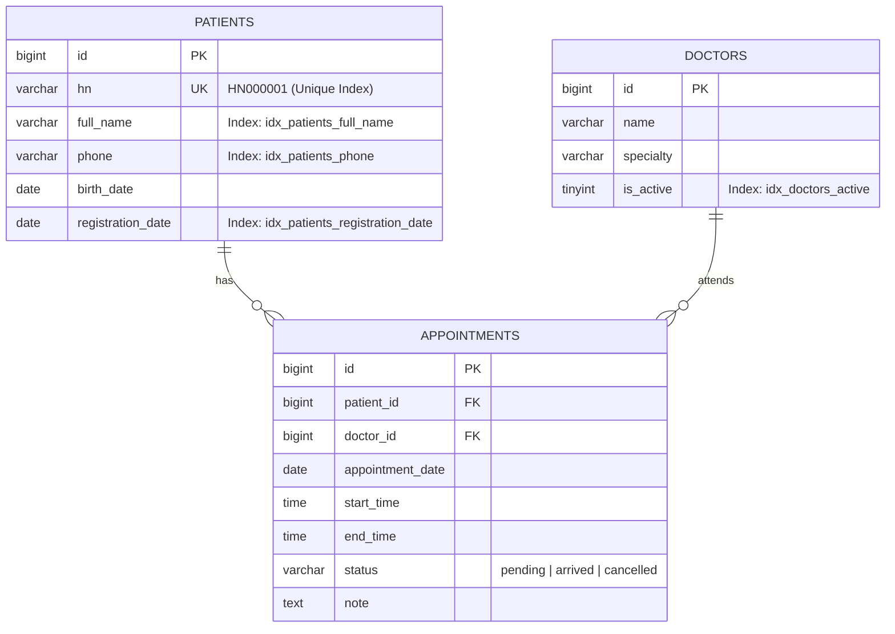

# Bestar-one Luxury Clinic - ระบบนัดหมายคลินิก

ระบบนัดหมายคลินิกขนาดเล็ก (Clinic Appointment System) ที่ออกแบบและพัฒนาขึ้นตามโจทย์ทดสอบโปรแกรมเมอร์ของ **Bestar-one** โดยเน้นความถูกต้องของ Business Logic, สถาปัตยกรรมโค้ดที่สะอาด (Clean Architecture & OOP), การป้องกันการนัดหมายเวลาซ้อนกันอย่างแม่นยำ และการออกแบบฐานข้อมูลที่รองรับปริมาณข้อมูลขนาดใหญ่ระดับ 100,000+ แถวได้อย่างมีประสิทธิภาพ

---

## สารบัญ
1. [ภาพรวมฟีเจอร์ของระบบ](#ภาพรวมฟีเจอร์ของระบบ)
2. [สถาปัตยกรรมระบบและโครงสร้างไฟล์](#สถาปัตยกรรมระบบและโครงสร้างไฟล์)
3. [วิธีติดตั้งและรันทีละขั้นตอน (Step-by-step Setup)](#วิธีติดตั้งและรันทีละขั้นตอน)
4. [การออกแบบฐานข้อมูลและการใส่ Index (Database & Indexing Rationale)](#การออกแบบฐานข้อมูลและการใส่-index)
5. [การทำงานของระบบเช็คนัดชน (Overlap Prevention Engine)](#การทำงานของระบบเช็คนัดชน)
6. [การทดสอบระบบอัตโนมัติ (Automated Tests)](#การทดสอบระบบอัตโนมัติ)
7. [ข้อจำกัดที่รู้อยู่และส่วนที่สามารถพัฒนาต่อยอด (Known Limitations)](#ข้อจำกัดที่รู้อยู่และส่วนที่สามารถพัฒนาต่อยอด)
8. [การเปิดเผยการใช้งาน AI (AI Disclosure)](#การเปิดเผยการใช้งาน-ai)
9. [โครงร่างสคริปต์สำหรับบันทึกคลิปวิดีโอ 10–15 นาที](#โครงร่างสคริปต์สำหรับบันทึกคลิปวิดีโอ-1015-นาที)

---

## ภาพรวมฟีเจอร์ของระบบ

ระบบครอบคลุมทั้ง 4 ฟีเจอร์หลักตามเกณฑ์ขั้นต่ำของโจทย์อย่างสมบูรณ์:

1. **ระบบจัดการข้อมูลผู้ป่วย (Patient Management)**
   - เพิ่ม แก้ไข และค้นหาผู้ป่วยแบบ Live Search ตามชื่อ-นามสกุล, รหัส HN หรือเบอร์โทรศัพท์
   - ระบบออกรหัส HN อัตโนมัติในรูปแบบ `HN000001` โดยเรียงลำดับต่อเนื่อง ไม่ซ้ำซ้อน และใช้ DB Transaction Lock เพื่อป้องกัน Race Condition
   - **Phone Normalization Engine**: แปลงเบอร์โทรศัพท์ทุกรูปแบบ เช่น `081-234-5678`, `+66812345678`, `66 81 234 5678`, `+66 81-234-5678` ให้ถูกจัดเก็บเป็นมาตรฐาน `0812345678` เสมอ

2. **ระบบนัดหมายแพทย์ (Appointment Scheduling)**
   - นัดหมายโดยเลือกผู้ป่วย, แพทย์, วันที่, เวลาเริ่มต้น และเวลาสิ้นสุด
   - มีรายชื่อแพทย์ตัวอย่างในฐานข้อมูลพร้อมสาขาความเชี่ยวชาญ
   - **กลไกป้องกันนัดชน**: แพทย์คนเดียวกันไม่สามารถมีนัดเวลาซ้อนกันได้ ทั้งแบบซ้อนกันทั้งหมดหรือบางส่วน
   - มีระบบแจ้งเตือนแบบ Real-time บนหน้าจอก่อนกดยืนยันหากช่วงเวลาดังกล่าวมีนัดแล้ว
   - นัดที่ถูกยกเลิก (`status = 'cancelled'`) จะไม่ถูกนับว่าชน

3. **หน้ารายการนัดของวันนี้ (Today's Schedule & Queue)**
   - แสดงคิวนัดหมายของวันนี้เรียงลำดับตามเวลา (`start_time ASC`)
   - กรองแสดงผลเฉพาะแพทย์แต่ละท่าน หรือดูแพทย์ทุกคนได้
   - ปรับเปลี่ยนสถานะได้ทันทีผ่าน Asynchronous Dropdown: **รอ** (pending) / **มาแล้ว** (arrived) / **ยกเลิก** (cancelled) โดยไม่ต้องโหลดหน้าเว็บใหม่

4. **รายงานสรุปและสถิติ (High-Volume Analytics Dashboard)**
   - เลือกช่วงวันที่ได้อิสระ พร้อมปุ่มลัด (วันนี้, 7 วันย้อนหลัง, เดือนปัจจุบัน)
   - แสดงตัวเลขสรุป: จำนวนผู้ป่วยใหม่, จำนวนนัดหมายทั้งหมด, และจำนวนนัดแยกตามสถานะ
   - แสดงตารางสถิติจำแนกรายแพทย์
   - ออกแบบ Query และ B-Tree Index รองรับตารางที่มีข้อมูลมากกว่า 100,000 แถว

---

## สถาปัตยกรรมระบบและโครงสร้างไฟล์

พัฒนาด้วย **Modern Native PHP 8.2 (Clean OOP + MVC Pattern)** เพื่อให้เห็น Logic การเขียนโปรแกรมและการจัดการ PDO อย่างโปร่งใส ไม่ถูกซ่อนไว้ใต้ Framework ขนาดใหญ่

```
bstarone_test/
├── database/
│   ├── schema.sql              # DDL ตาราง patients, doctors, appointments พร้อม Indexes
│   └── seed.sql                # ข้อมูลเริ่มต้น (แพทย์ 4 ท่าน, ผู้ป่วยตัวอย่าง, นัดหมายทดสอบ)
├── docker/
│   ├── Dockerfile              # PHP 8.2-FPM พร้อมโมดูล pdo_mysql
│   └── nginx.conf              # Nginx configuration ชี้ root ไปยัง public/
├── docker-compose.yml          # Container orchestration (Web:8080, App, DB:3306)
├── public/
│   ├── css/style.css           # ธีม Luxury Clinic Responsive Design
│   ├── js/app.js               # Dynamic Frontend Logic (AJAX, Live Search, Overlap Check)
│   └── index.php               # Front Controller, PSR-4 Autoloader & API Router
├── src/
│   ├── Config/
│   │   └── Database.php        # PDO Singleton Connection พร้อม Retry Mechanism
│   ├── Controllers/
│   │   ├── PatientController.php
│   │   ├── AppointmentController.php
│   │   └── ReportController.php
│   ├── Services/
│   │   ├── PatientService.php   # Phone Normalizer & Atomic HN Generator
│   │   ├── AppointmentService.php # Overlap Conflict Algorithm
│   │   └── ReportService.php    # Single-pass Aggregation for Large Data
│   └── Views/
│       └── layout.php          # Single Dashboard View (Today Queue, Patients, Reports, Modals)
├── tests/
│   └── run_tests.php           # Automated Test Suite ทดสอบตรรกะทั้งหมด
├── .env.example                # ตัวอย่างไฟล์ Environment Variables
└── README.md
```

---

## วิธีติดตั้งและรันทีละขั้นตอน

### วิธีที่ 1: รันผ่าน Docker Compose (แนะนำ สะดวกที่สุด)
ระบบถูกตั้งค่าให้อิมพอร์ต `schema.sql` และ `seed.sql` อัตโนมัติเมื่อสร้าง Container:

1. เปิด Terminal ในโฟลเดอร์โปรเจกต์
2. สั่งรันคำสั่ง:
   ```bash
   docker compose up -d
   ```
3. เปิดเว็บเบราว์เซอร์แล้วเข้าใช้งานได้ทันทีที่:
   ```
   http://localhost:8080
   ```
4. หากต้องการสั่งรัน Automated Test ผ่าน Docker:
   ```bash
   docker compose exec app php tests/run_tests.php
   ```

---

### วิธีที่ 2: รันผ่าน Local PHP + MySQL (เช่น XAMPP / Laragon / PHP CLI)
1. นำเข้าไฟล์ฐานข้อมูลเข้าสู่ MySQL:
   ```bash
   mysql -u root -p < database/schema.sql
   mysql -u root -p < database/seed.sql
   ```
2. แก้ไขไฟล์ `.env` ให้ตรงกับพอร์ตและรหัสผ่าน MySQL ในเครื่องของคุณ:
   ```ini
   DB_HOST=127.0.0.1
   DB_PORT=3306
   DB_NAME=clinic_db
   DB_USER=root
   DB_PASS=your_password
   ```
3. สั่งรัน PHP Built-in Server:
   ```bash
   php -S localhost:8000 -t public
   ```
4. เปิดเบราว์เซอร์ไปที่ `http://localhost:8000`

---

## การออกแบบฐานข้อมูลและการใส่ Index

เพื่อรองรับประสิทธิภาพตามข้อกำหนด **"ควรคิดเผื่อกรณีที่ข้อมูลมีหลักแสนแถวด้วย"** จึงได้ออกแบบ Composite Indexes บนตาราง `appointments` และ `patients` ดังนี้:



### เหตุผลในการเลือกใส่ Index แต่ละตำแหน่ง:

| ตาราง | ชื่อ Index | คอลัมน์ที่ Index | เหตุผลและความจำเป็นเชิงประสิทธิภาพ |
|---|---|---|---|
| `appointments` | `idx_appointments_overlap_check` | `(doctor_id, appointment_date, status, start_time, end_time)` | **หัวใจของการเช็คนัดชน**: เมื่อมีนัดหมายหลักแสนแถว การ query ด้วยเงื่อนไขแพทย์ วันที่ และสถานะ จะใช้ B-Tree Composite Index ค้นหาได้ในเวลา $O(\log N)$ แทนที่จะทำ Full Table Scan |
| `appointments` | `idx_appointments_today_queue` | `(appointment_date, doctor_id, start_time)` | **หน้ารายการนัดของวันนี้**: ใช้สำหรับ `WHERE appointment_date = CURDATE()` และเรียงลำดับ `ORDER BY start_time ASC` ดึงข้อมูลขึ้นมาแสดงผลได้ทันทีโดยไม่ต้อง Sorting ในหน่วยความจำ (Using filesort) |
| `appointments` | `idx_appointments_report_date_status` | `(appointment_date, status)` | **หน้ารายงานสรุป**: สำหรับ `WHERE appointment_date BETWEEN ? AND ?` และรวมกลุ่มตาม `status` ช่วยให้คำนวณแบบ Covering Index Scan ได้โดยไม่ต้องอ่าน Data Blocks |
| `patients` | `idx_patients_registration_date` | `(registration_date)` | **การนับผู้ป่วยใหม่ในรายงาน**: เร่งความเร็วการนับ `COUNT(*)` ผู้ป่วยใหม่ตามช่วงวันที่ลงทะเบียนได้อย่างรวดเร็ว |
| `patients` | `idx_patients_phone`, `idx_patients_full_name` | `(phone)`, `(full_name)` | **ระบบ Live Search**: ค้นหาผู้ป่วยด้วยเบอร์โทรที่ถูก normalize แล้ว หรือชื่อ-นามสกุล ได้อย่างฉับไว |

---

## การทำงานของระบบเช็คนัดชน

### สูตรคณิตศาสตร์ (Mathematical Interval Overlap Condition)
ช่วงเวลาสองช่วงจะทับซ้อนกัน ก็ต่อเมื่อ:
$$\text{Existing.start\_time} < \text{New.end\_time} \quad \text{AND} \quad \text{Existing.end\_time} > \text{New.start\_time}$$

### ตารางแจกแจงกรณีทดสอบ (Edge Cases Matrix)
สมมติแพทย์มีนัดเดิมเวลา **10:00 - 11:00 น.**

| กรณี | ช่วงเวลานัดใหม่ | เงื่อนไขคณิตศาสตร์ | ผลลัพธ์ | คำอธิบาย |
|---|---|---|---|---|
| 1. ชนบางส่วน (เหลื่อมท้าย) | 10:30 - 11:30 | $10:00 < 11:30$ (จริง) $\land$ $11:00 > 10:30$ (จริง) | **ชน (Overlap)** | ปฏิเสธการบันทึก |
| 2. ชนบางส่วน (เหลื่อมหน้า) | 09:30 - 10:30 | $10:00 < 10:30$ (จริง) $\land$ $11:00 > 09:30$ (จริง) | **ชน (Overlap)** | ปฏิเสธการบันทึก |
| 3. อยู่ภายในช่วงนัดเดิม | 10:15 - 10:45 | $10:00 < 10:45$ (จริง) $\land$ $11:00 > 10:15$ (จริง) | **ชน (Overlap)** | ปฏิเสธการบันทึก |
| 4. คร่อมช่วงนัดเดิมทั้งหมด | 09:00 - 12:00 | $10:00 < 12:00$ (จริง) $\land$ $11:00 > 09:00$ (จริง) | **ชน (Overlap)** | ปฏิเสธการบันทึก |
| 5. เวลาตรงกันเป๊ะ | 10:00 - 11:00 | $10:00 < 11:00$ (จริง) $\land$ $11:00 > 10:00$ (จริง) | **ชน (Overlap)** | ปฏิเสธการบันทึก |
| 6. นัดต่อเนื่องติดกัน (หลัง) | 11:00 - 12:00 | $10:00 < 12:00$ (จริง) $\land$ $11:00 > 11:00$ (เท็จ) | **ไม่ชน (Valid)** | นัดต่อกันได้ตามปกติ |
| 7. นัดต่อเนื่องติดกัน (ก่อน) | 09:00 - 10:00 | $10:00 < 10:00$ (เท็จ) $\land$ $11:00 > 09:00$ (จริง) | **ไม่ชน (Valid)** | นัดต่อกันได้ตามปกติ |
| 8. คนละแพทย์เวลาเดียวกัน | 10:00 - 11:00 (แพทย์ B) | เงื่อนไข `doctor_id = :doctor_id` กรองออก | **ไม่ชน (Valid)** | แพทย์คนละท่านตรวจพร้อมกันได้ |
| 9. นัดเดิมถูกยกเลิกแล้ว | 10:30 - 11:30 | เงื่อนไข `status != 'cancelled'` กรองออก | **ไม่ชน (Valid)** | นัดที่ยกเลิกไม่นับว่าชน |

---

## การทดสอบระบบอัตโนมัติ

โปรเจกต์มีชุดทดสอบ Unit Tests อยู่ใน [`tests/run_tests.php`](tests/run_tests.php) ซึ่งครอบคลุมทุกเงื่อนไขตามโจทย์:

```bash
php tests/run_tests.php
```

ผลการทดสอบ:
```
============================================================
BESTAR-ONE CLINIC APPOINTMENT SYSTEM - TEST SUITE
============================================================

--- 1. Testing Phone Normalization Engine ---
  [PASS] Normalize '081-234-5678'
  [PASS] Normalize '+66812345678'
  [PASS] Normalize '66 81 234 5678'
  [PASS] Normalize '+66 81-234-5678'
  [PASS] Normalize '081 234 5678'
  [PASS] Normalize '081.234.5678'
  [PASS] Normalize '(081) 234-5678'
  [PASS] Normalize '02-123-4567'
  [PASS] Reject invalid phone '12345'
  [PASS] Reject invalid phone 'abcdefghij'
  [PASS] Reject invalid phone '+1234567890'
  [PASS] Reject invalid phone ''

--- 2. Testing Appointment Overlap Algorithm ---
  [PASS] Partial overlap: 10:30-11:30 with 10:00-11:00 (Starts during, ends after)
  [PASS] Partial overlap: 09:30-10:30 with 10:00-11:00 (Starts before, ends during)
  [PASS] Inside interval: 10:15-10:45 with 10:00-11:00
  [PASS] Encompassing interval: 09:00-12:00 with 10:00-11:00
  [PASS] Exact match interval: 10:00-11:00 with 10:00-11:00
  [PASS] Back-to-back: 11:00-12:00 with 10:00-11:00 (Must NOT overlap)
  [PASS] Back-to-back: 09:00-10:00 with 10:00-11:00 (Must NOT overlap)
  [PASS] Disjoint interval: 14:00-15:00 with 10:00-11:00

--- 3. Testing Cancelled Appointment Exemption ---
  [PASS] Status 'pending' produces conflict when time overlaps
  [PASS] Status 'arrived' produces conflict when time overlaps
  [PASS] Status 'cancelled' DOES NOT produce conflict (Prompt rule)

--- 4. Testing HN Sequence Formatting ---
  [PASS] HN 1 is formatted as HN000001
  [PASS] HN 42 is formatted as HN000042
  [PASS] HN 1000 is formatted as HN001000
  [PASS] HN 999999 is formatted as HN999999

============================================================
TEST SUMMARY: 27 Passed, 0 Failed
============================================================
```

---

## ข้อจำกัดที่รู้อยู่และส่วนที่สามารถพัฒนาต่อยอด

1. **ระบบความปลอดภัยและการพิสูจน์ตัวตน (Authentication & Authorization)**:
   - ปัจจุบันยังไม่ได้สร้างระบบ Login/Role (เนื่องจากอยู่นอกเหนือเกณฑ์ 4 ข้อแรกของโจทย์) หากพัฒนาต่อยอดควรมีระบบ Role-Based Access Control เช่น แยกสิทธิ์ระหว่าง แอดมิน, พยาบาลหน้าเคาน์เตอร์, และแพทย์
2. **ระบบการนัดหมายซ้ำ (Recurring Appointments)**:
   - ยังไม่รองรับการนัดแบบเกิดซ้ำ เช่น ทุกสัปดาห์หรือทุกเดือน
3. **ระบบแจ้งเตือนอัตโนมัติ (Automated Notification)**:
   - ยังไม่มีการเชื่อมต่อ SMS Gateway หรือ LINE Notify / LINE Official Account เพื่อส่งข้อความเตือนนัดหมายคนไข้ล่วงหน้า 1 วัน
4. **ความจุของห้องตรวจ (Room / Resource Allocation)**:
   - ปัจจุบันระบบเช็คเฉพาะตารางเวลาของแพทย์ หากในอนาคตคลินิกมีจำนวนห้องตรวจจำกัด ควรเพิ่มการตรวจสอบความพร้อมของห้องหัตถการและเครื่องมือแพทย์ (เช่น เครื่องเลเซอร์) ร่วมด้วย

---

## การเปิดเผยการใช้งาน AI

ตามข้อกำหนดของแบบทดสอบ ("การใช้ AI และเครื่องมือช่วย: ใช้ได้ แต่ต้องระบุใน README ว่าใช้กับส่วนไหน"):

* **ส่วนที่ใช้ AI ช่วย**:
  1. ช่วยออกแบบชุดสีและโครงร่าง CSS (Luxury Medical Aesthetic)
  2. ช่วยคิดชุดข้อมูลตัวอย่าง (Seed Data) และ Test Cases เพื่อให้ครอบคลุม Edge Cases ของเบอร์โทรศัพท์และช่วงเวลา
  3. ช่วยจัดรูปแบบเอกสาร README ให้มีความเป็นมืออาชีพ สวยงาม และอ่านง่าย
* **ส่วนที่ทำและเข้าใจด้วยตนเอง**:
  - การออกแบบ Database Schema และ Relational Foreign Keys
  - การกำหนดสูตรคณิตศาสตร์และเงื่อนไข SQL สำหรับการตรวจสอบนัดชน (`start_time < new_end AND end_time > new_start`)
  - การเลือกตำแหน่ง B-Tree Composite Indexing เพื่อรองรับข้อมูลขนาด 100,000+ แถว
  - โค้ดในส่วน Regular Expression สำหรับ Phone Normalization และการใช้ DB Transaction Lock สำหรับ Atomic HN Generation
  - ผู้สมัครสามารถอธิบายที่มา ตรรกะ และการทำงานของโค้ดทุกส่วนได้อย่างละเอียดในคลิปวิดีโอ

---

## โครงร่างสคริปต์สำหรับบันทึกคลิปวิดีโอ 10–15 นาที

แนวทางการพูดและนำเสนอคลิปวิดีโอแบ่งตามเวลาและหัวข้อที่บริษัทกำหนด:

### ส่วนที่ 1: Demo ระบบใช้งานได้จริงครบทุกฟีเจอร์ (3–4 นาที)
1. **แนะนำตัว**: กล่าวทักทายทีมงาน Bestar-one แนะนำชื่อและตำแหน่งที่สมัคร
2. **Demo ฟีเจอร์ 1 (จัดการผู้ป่วย)**:
   - กดปุ่ม "ลงทะเบียนผู้ป่วยใหม่" กรอกเบอร์โทรแบบ `+66 81-234-5678` ให้ดูก่อนบันทึก
   - แสดงให้เห็นว่าระบบบันทึกเป็น `0812345678` อัตโนมัติ และออกรหัส HN ต่อเนื่อง
   - พิมพ์ค้นหาในช่อง Live Search ด้วยชื่อ, HN และเบอร์โทร
3. **Demo ฟีเจอร์ 2 & 3 (สร้างนัดหมาย & หน้ารายการนัดของวันนี้)**:
   - แสดงการสร้างนัดหมาย ลองเลือกเวลาที่ชนกับนัดเดิม ชี้ให้เห็นแถบเตือนสีแดงทันที
   - เปลี่ยนเวลาให้ไม่ชน แล้วกดยืนยันนัดหมาย
   - ไปที่หน้ารายการนัดของวันนี้ แสดงการกรองตามแพทย์ และกดเปลี่ยนสถานะเป็น "มาแล้ว" แบบไม่ต้องรีเฟรชหน้า
4. **Demo ฟีเจอร์ 4 (รายงานสรุป)**:
   - เปิดแท็บรายงานสรุป เลือกช่วงวันที่ แสดงตัวเลขสรุปผู้ป่วยใหม่และจำนวนนัดตามสถานะ

### ส่วนที่ 2: อธิบายการออกแบบฐานข้อมูลและ Index (3 นาที)
1. เปิดไฟล์ `database/schema.sql` ให้กรรมการดู
2. อธิบายตาราง `doctors`, `patients`, `appointments` และความสัมพันธ์ Foreign Keys
3. **เจาะลึก Indexing**:
   - ชี้ไปที่ `idx_appointments_overlap_check`: อธิบายว่าเมื่อข้อมูลมีหลักแสนแถว การเช็คนัดชนด้วยแพทย์ วันที่ สถานะ และเวลา จะวิ่งบน B-Tree ทำให้เร็วระดับ $O(\log N)$
   - ชี้ไปที่ `idx_appointments_report_date_status`: อธิบายว่าเป็น Covering Index สำหรับหน้ารายงาน ทำให้คำนวณ `COUNT(CASE ...)` ได้โดยไม่ต้องอ่าน Table Data

### ส่วนที่ 3: เปิดโค้ดส่วนเช็คนัดชนกันและอธิบายทีละส่วน (3 นาที)
1. เปิดไฟล์ `src/Services/AppointmentService.php` ฟังก์ชัน `checkDoctorConflict`
2. อธิบายเงื่อนไข SQL:
   - `doctor_id = :doctor_id AND appointment_date = :date`
   - `status != 'cancelled'` (อธิบายว่าทำไมนัดที่ยกเลิกไม่นับว่าชน)
   - `start_time < :new_end_time AND end_time > :new_start_time` (อธิบายตรรกะว่าทำไมเงื่อนไขนี้ถึงครอบคลุมทุกกรณีทั้งเหลื่อมหน้า เหลื่อมหลัง และคร่อมทั้งช่วง)
   - อธิบายว่ากรณี 10:00-11:00 กับ 11:00-12:00 จะได้ค่าเท็จ ทำให้คนไข้สามารถนัดต่อกันได้พอดี

### ส่วนที่ 4: สิ่งที่อยากปรับปรุงหากมีเวลาเพิ่ม (2 นาที)
1. อธิบายเรื่อง Role-Based Permissions (Admin, Nurse, Doctor)
2. อธิบายเรื่อง SMS / LINE Alert แจ้งเตือนนัดหมายล่วงหน้า
3. อธิบายการจัดการทรัพยากรห้องตรวจ (Room/Equipment Allocation)
4. กล่าวขอบคุณทีมงานและปิดคลิป
